<h1 align="center">
  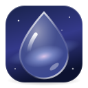<br>
  Liquid Glass for Fedora
</h1>

<p align="center">A glass theme for the whole Fedora GNOME desktop, with an app to tune it from liquid to frosted.</p>

<p align="center">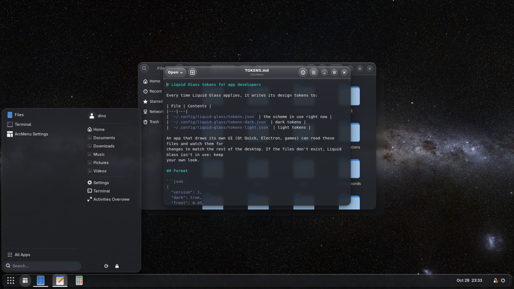</p>

Liquid Glass makes GNOME Shell, Dash to Panel, ArcMenu, GTK 4 and libadwaita apps, GTK 3 apps,
Nautilus, Ptyxis, Qt apps and a long list of everyday apps look like layered glass: translucent
surfaces with real blur and refraction behind them, a bright rim of light along the top edge, and
rounded, calm controls. One slider takes everything from clear **liquid** glass to milky **frosted**
glass, and every change can be undone with one click.

Made for **Fedora 44 Workstation with GNOME 50**.

## The app

<p align="center">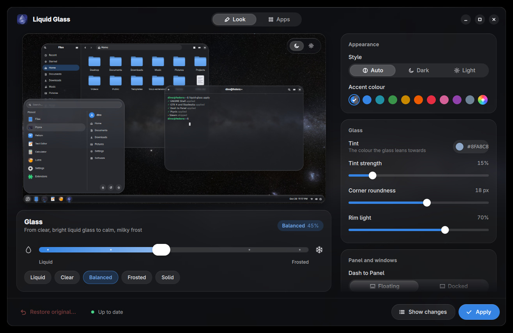</p>

- **Live preview** of your own desktop (your wallpaper, panel, menu and windows) that follows every
  change as you drag.
- **Liquid ↔ Frosted** slider, plus presets: Liquid, Clear, Balanced, Frosted, Solid.
- Accent colour (follows GNOME's by default), glass tint, corner roundness, rim light, a floating or
  docked panel, terminal opacity and a Reduce transparency switch.
- **Glass effects**: how much the rim bends, the rainbow edge, how vivid colours look through the
  glass, which surfaces get glass, and whether the panel and menus show the windows behind them.
- **Apps** page: every part of the desktop it can theme, whether it's installed, and a switch for each.
- **Show changes** lists every file and setting Apply will touch, before it touches anything.
- **Restore original** puts your desktop back exactly as it was before the first Apply.

<p align="center">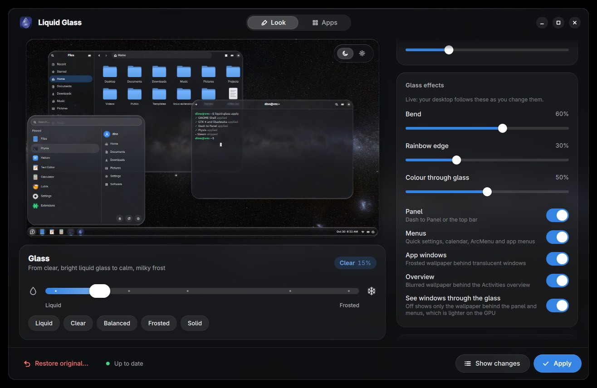</p>

<p align="center">
  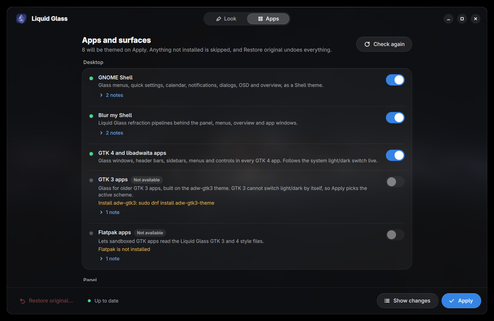
  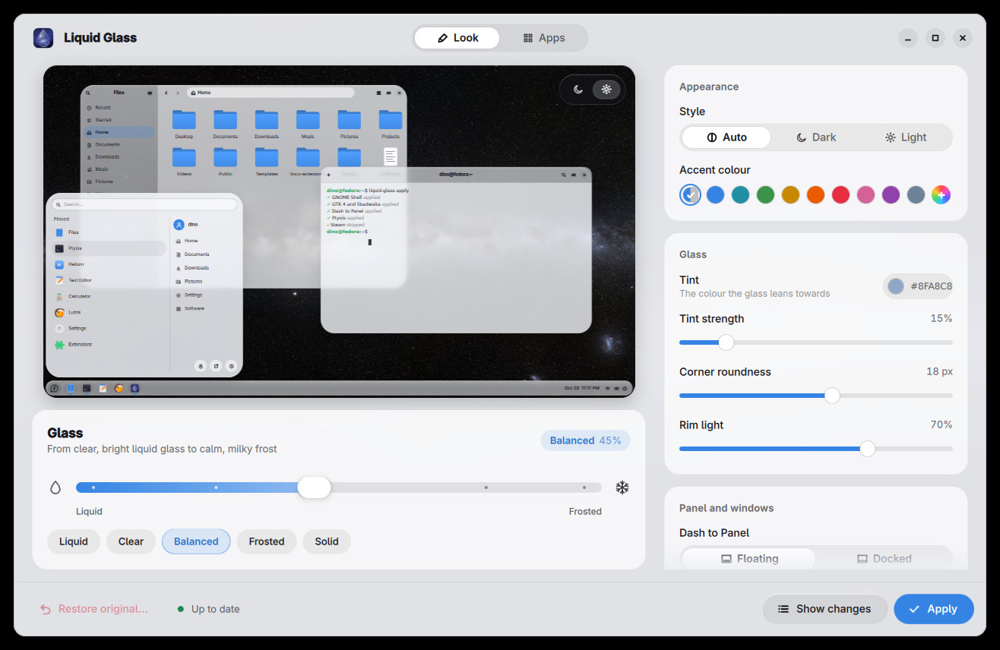
</p>

## Install

```sh
git clone https://github.com/djshiye/fedora-liquid-glass
cd fedora-liquid-glass
./install.sh
```

The installer works in your home folder and needs no root, except to add missing Fedora packages,
which it lists and asks about first: `python3-pyside6` (the app), `adw-gtk3-theme` (GTK 3 apps),
`kvantum` (Qt apps) and `gnome-shell-extension-user-theme` (the Shell theme). Then open **Liquid
Glass** from the app grid, pick a look and press **Apply**.

The glass itself comes from Liquid Glass's own GNOME Shell extension, installed by the first
**Apply**. Log out and back in once so GNOME Shell loads it; after that, the desktop follows the
app's sliders live, before you even press Apply. Blur my Shell isn't needed. If you have it, the
parts of it that would blur the same surfaces twice are switched off (and switched back on by
**Restore original**).

**Update:** `git pull && ./install.sh`. **Uninstall:** `./uninstall.sh` (restores your original look first).

## What it themes

| Part | How |
|---|---|
| GNOME Shell | A Shell theme: menus, quick settings, calendar, notifications, dialogs, OSD, overview |
| Liquid Glass effects | Its own Shell extension: live blur, a refracting rim, rim light and a rainbow edge behind the panel, menus, quick settings, calendar, notifications, OSD, Alt+Tab, app windows and the overview |
| Dash to Panel | Glass panel, floating or docked, hover and running-app dots. Your layout is untouched |
| ArcMenu | Glass menu, menu button and search pill |
| GTK 4 and libadwaita | Every GTK 4 app, Nautilus included. Switches dark/light live with the system |
| GTK 3 | On top of adw-gtk3 (Lutris, LibreOffice and other older apps) |
| Flatpak apps | Lets sandboxed GTK apps read the theme |
| Ptyxis, GNOME Terminal | Glass palette and window opacity on every profile |
| btop, micro | Matching colour themes with a see-through background |
| Qt apps | A Kvantum theme built from your settings (qBittorrent, btrfs-assistant, ProtonUp-Qt...) |
| Discord (Vencord), VS Code, Obsidian, qBittorrent, Prism Launcher | Their own theme formats, installed and selected |
| Brave, Helium | A Chromium theme extension, loaded once by hand |
| Clipperino, RGBeast, Wheelguard | Clipperino and RGBeast through GTK 4; Wheelguard reads the Liquid Glass colours itself |

Some apps can't be themed and the app says so plainly: Steam, Zoom and Claude Desktop draw their own
UI, and Slack only takes a pasted colour string (the app shows it, ready to copy).

<p align="center">
  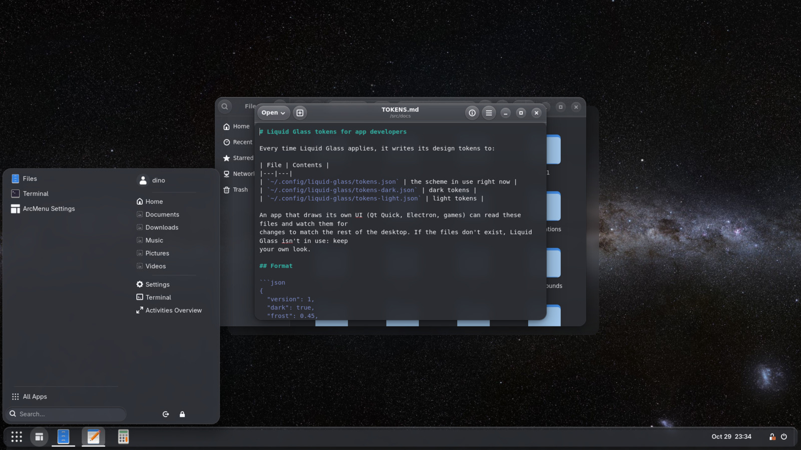
  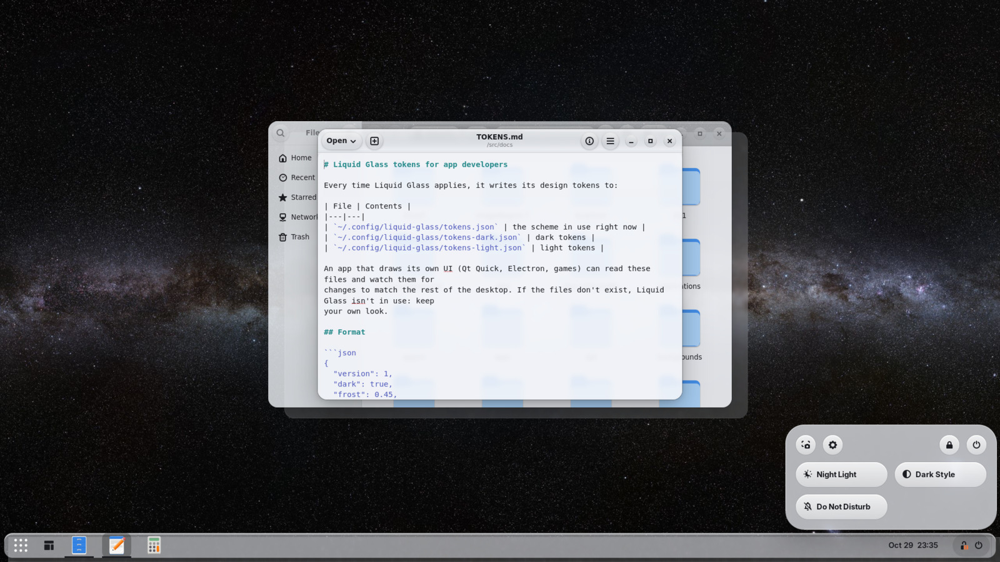
</p>
<p align="center">
  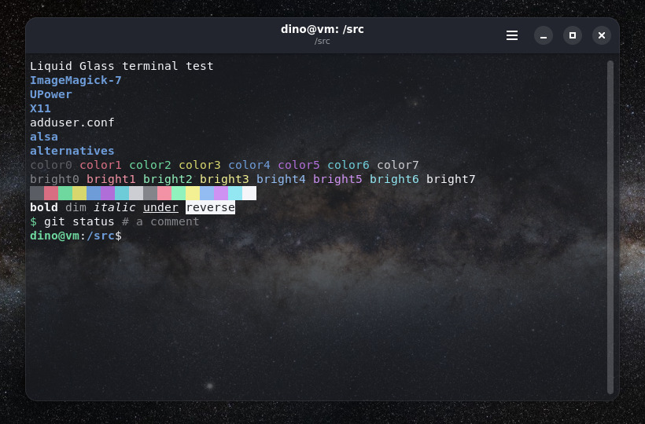
  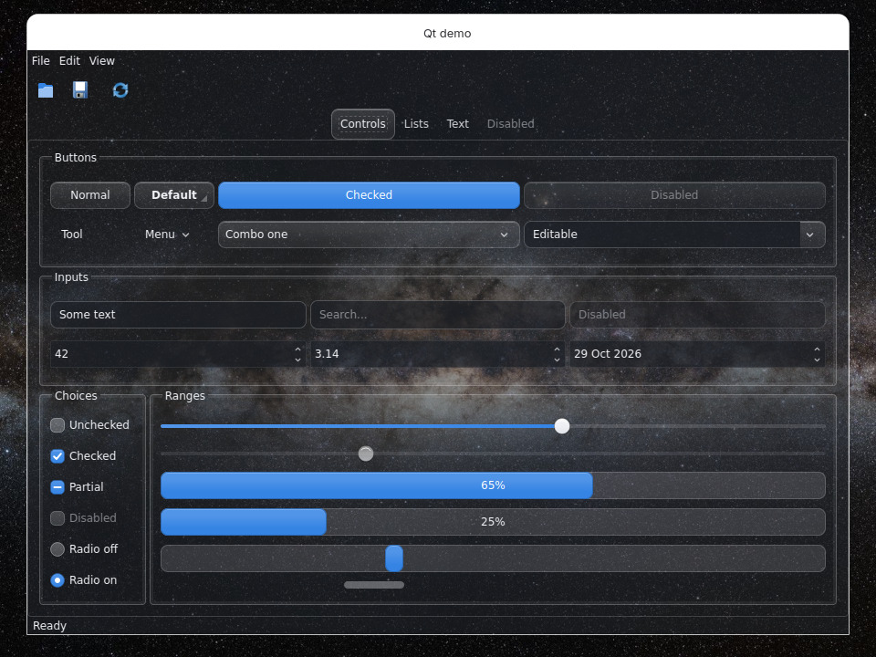
</p>

## How the glass works

The extension puts a pane behind each Shell surface. The pane holds a live copy of what is behind
it (the wallpaper and the windows under it), blurs it, and looks at it through a slab of glass whose
top edge rounds off, like a glass paperweight. The optics follow real glass:

- **Refraction:** every view ray bends by Snell's law (index 1.5, like crown glass) where it enters the
  curved edge, then travels down through the slab to the backdrop. That is why the rim magnifies
  and bends what is behind it while the flat middle stays true.
- **Dispersion:** the index changes with wavelength by Cauchy's equation. The shader traces five
  wavelengths from blue to red, so the edge splits light into a faint rainbow, as a prism does.
- **Reflection:** Fresnel's equations (Schlick's form) decide how much the surface mirrors: about 4%
  head-on and nearly all of it at grazing angles, which is why real glass edges glow.
- **Highlights:** a low light from the top left gives a sharp highlight where the rim faces it. The
  same light, reflected inside the glass, comes out dimmer on the opposite rim.
- **Absorption:** by the Beer-Lambert law, light that travels further through the glass comes out
  very slightly darker.

Reflections are drawn above each menu, because light reflects off the top of the glass, over its
tint. The surface shape is ported from Kyant's
[AndroidLiquidGlass](https://github.com/Kyant0/AndroidLiquidGlass) (Apache 2.0, see
[THIRD-PARTY-NOTICES.md](THIRD-PARTY-NOTICES.md)). The app's preview uses the same optics, so what
you see there is what you get on the desktop.

<p align="center">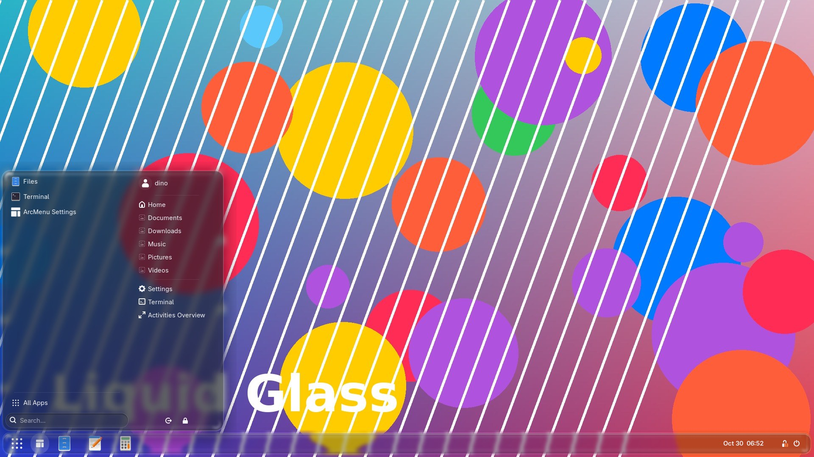</p>

## Safe by design

- Everything runs as you. No root, no `sudo` from the app, no network access.
- Before the first change to any file or setting, the original is saved in
  `~/.local/state/liquid-glass/backup`. Turning a part off restores just that part; **Restore
  original** restores everything. Shared lists (enabled extensions, Flatpak permissions) are undone
  item by item, so changes you made since are kept.
- It never writes through symbolic links into other themes, and Flatpak apps only get read-only
  access to the theme files.
- Text stays readable: content areas are always more solid than chrome, and the colours are tested
  for 4.5:1 contrast at every slider position.

## Command line

```sh
liquid-glass                       # open the app
liquid-glass apply --frost 0.3     # 0 = liquid, 1 = frosted
liquid-glass apply --preset Frosted
liquid-glass plan                  # what apply would change
liquid-glass status                # which parts are available
liquid-glass revert                # restore the original look
```

A small user service (`liquid-glass-watch`) re-applies the parts that can't follow the system
dark/light switch by themselves (Shell theme, GTK 3, terminals, Qt) when you flip Dark Style.

## For app developers

Liquid Glass writes its colours to `~/.config/liquid-glass/tokens*.json` on every Apply, so an app
that draws its own UI can match the desktop. See [docs/TOKENS.md](docs/TOKENS.md).

## Development

```sh
python3 -m pytest -q          # tests
python3 -m liquidglass gui    # run the app from the source tree
```

## License

[MIT](LICENSE). The ported lens shader is Apache 2.0, see [THIRD-PARTY-NOTICES.md](THIRD-PARTY-NOTICES.md).
